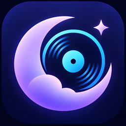

<div align="center">



# 網易雲 × Discord

**在 Discord 即時分享你的網易雲音樂播放狀態**

[](https://github.com/ZeroTwo02franxx/netease-discord-presence/releases/latest)
-0078D6)


</div>

---

## ✨ 功能特色

- **開箱即用**：提供單一免安裝執行檔，不需另裝 .NET、免申請設定，打開就能同步。
- **完整曲目顯示**：即時顯示歌名、歌手、專輯封面與播放進度條（含拖曳跳轉與單曲循環）。
- **暫停不消失**：暫停音樂時保留歌曲與封面並標示 `· 已暫停`；停止同步或關閉視窗才清除狀態。
- **多開 Discord 支援**：可掃描並指定要顯示狀態的 Discord 帳號，不誤連其他視窗。
- **低調常駐**：可縮到系統匣背景運行，斷線時自動退避重連；不會自動開機啟動。
- **隱私優先**：不讀取網易雲帳號或 Discord Token，無第三方後端服務。

---

## 🚀 快速開始

1. 前往 **[Releases 頁面](https://github.com/ZeroTwo02franxx/netease-discord-presence/releases/latest)** 下載最新壓縮檔並解壓縮。
2. 開啟並登入 **Discord 電腦版** 與 **網易雲音樂電腦版**。
   - 確認 Discord 設定 → **活動隱私** → 已開啟「將目前活動分享為狀態訊息」。
3. 點兩下開啟 `CloudMusicPresence.exe`，按 **「開始同步」** 即可。

> **提示**：首次執行若 Windows 顯示 SmartScreen 保護提醒，點選「其他資訊」→「仍要執行」即可。

---

## ⚙️ 進階設定（選用）

點選主畫面右下角 **「進階設定 ▾」** 可展開以下選項：

| 功能 | 說明 |
| :--- | :--- |
| **掃描帳號** | 多開 Discord 電腦版時，可掃描本機連線並選擇要顯示在哪個帳號。 |
| **自訂 Application ID** | 程式已內建預設值可直接使用；若想更改 Discord 上顯示的應用程式名稱，可至 [Discord Developer Portal](https://discord.com/developers/applications) 建立 App 並填入 ID（不需建立 Bot 或 Token）。設定存於執行檔旁的 `settings.json`。 |
| **偵測播放來源** | 若抓不到歌曲或時間進度，可點此檢視 Windows 媒體工作階段與診斷訊息。 |

---

## 💻 系統需求與相容性

| 項目 | 支援狀況 |
| :--- | :--- |
| **作業系統** | Windows 10（2004 以上）／ Windows 11（64 位元） |
| **網易雲版本** | Windows 桌面版 3.x（完整支援進度條與封面）與 2.x 舊版（自動啟用視窗＋音訊備援模式，支援歌名、歌手、封面與暫停狀態） |
| **Discord 版本** | Windows 桌面版（透過本機 IPC Named Pipe 通訊） |
| **不支援項目** | 網頁版、手機版、同步歌詞 |

---

## 🔒 隱私與運作原理

- **不碰帳號憑證**：不讀取 Discord Token、不讀取網易雲登入資訊，也不對網易雲伺服器發送 API 請求。
- **只同步網易雲**：僅接受來源識別碼為網易雲（`cloudmusic` / `netease`）的系統媒體工作階段，不會誤抓 Spotify 或瀏覽器分頁。
- **封面網址白名單**：僅接受網易雲公開圖片 CDN（`*.music.126.net`）的 HTTPS 網址。

<details>
<summary><b>展開檢視技術細節（進度讀取與節流機制）</b></summary>

- **舊版網易雲（2.x）備援**：若 Windows SMTC 未列出網易雲，程式會自動改從 `OrpheusBrowserHost` 視窗標題取得歌名與歌手（縮到系統匣仍可讀取），搭配本機 `WebData/file/history` 與 `playingList` 比對專輯封面，並透過 Windows Core Audio 工作階段偵測播放／暫停狀態。
- **進度與封面**：優先使用 Windows SMTC；針對未提供 SMTC 時間的網易雲 v3，會比對 `cloudmusic.dll` 特徵碼並以唯讀權限（`PROCESS_VM_READ`）讀取歌曲 ID、播放狀態與進度欄位（不注入、不修改播放器），並比對本機 `WebData/file/playingList` 取得目前曲目之專輯封面。
- **Discord 更新節流**：本機每 250ms 輪詢，一般狀態更新至少間隔 1 秒並遵守 20.1 秒滾動視窗上限（最多 5 次，保留 1 格給清除狀態）；正常播放由 Discord 自行推進進度條，僅於換歌、暫停、進度跳轉（> 2 秒）或每 30 秒保活時發送。斷線重試採 5 / 10 / 20 / 40 / 60 秒退避。

</details>

---

## 🛠️ 從原始碼建置

需要安裝 **.NET 8 SDK**：

```powershell
# 建置專案
dotnet build

# 執行自動化測試（47 項檢查）
dotnet run --project tests/Tests.csproj

# 打包單一免安裝獨立執行檔（win-x64）
dotnet publish CloudMusicPresence.csproj -c Release -r win-x64 --self-contained true `
  -p:PublishSingleFile=true -p:IncludeNativeLibrariesForSelfExtract=true `
  -p:EnableCompressionInSingleFile=true -p:DebugType=none -p:DebugSymbols=false -o dist
```

---

## 📋 近期版本紀錄

完整發行檔案與歷史更新請見 **[GitHub Releases](https://github.com/ZeroTwo02franxx/netease-discord-presence/releases)**。

### v1.4.5
- 新增 **舊版網易雲（2.x）自動備援支援**：無須開啟系統媒體控制（SMTC）即可從視窗標題讀取歌名與歌手（含縮到系統匣狀態）。
- 支援從本機 `history` / `playingList` 依歌名與歌手自動比對專輯封面。
- 透過 Windows Core Audio 音訊工作階段與音量峰值偵測舊版網易雲的播放／暫停狀態。

### v1.4.4
- 全新簡潔主介面，將多開帳號、自訂 Application ID 與來源診斷收納至「進階設定 ▾」。
- 內建加密封裝之預設 Application ID，分享給朋友免設定即可直接同步。
- 暫停音樂時改為保留顯示歌曲並標示 `· 已暫停`（暫停期間停止發送進度條時間戳記）。
- 提供單一免安裝獨立執行檔（內含 .NET 8 執行環境），並在「掃描帳號」下方加上多開說明。

### v1.4.3
- 修正無總長度資訊時誤判拖曳進度導致觸發限流的問題。
- 改善切歌轉場瞬間的讀取穩定性，避免送出缺封面或無進度的半殘狀態。
- 保留播放器時間讀取的實際錯誤診斷訊息，並修正未連線失敗誤扣額度、掃描取消與 GDI 資源釋放。

### v1.4.2
- 啟用全新「Moonwave／月光唱片」應用程式圖示（內嵌至執行檔、視窗與系統匣）。

---

## 📄 授權與參考

- 網易雲 v3 播放器特徵碼與欄位布局參考自 [Kxnrl/NetEase-Cloud-Music-DiscordRPC](https://github.com/Kxnrl/NetEase-Cloud-Music-DiscordRPC)（MIT License），完整授權聲明見 [THIRD-PARTY-NOTICES.txt](THIRD-PARTY-NOTICES.txt)。
- 協定與 API 參考：[Discord RPC Documentation](https://github.com/discord/discord-api-docs/blob/main/developers/topics/rpc.mdx) · [Windows SMTC API](https://learn.microsoft.com/en-us/uwp/api/windows.media.control.globalsystemmediatransportcontrolssessionmanager)
